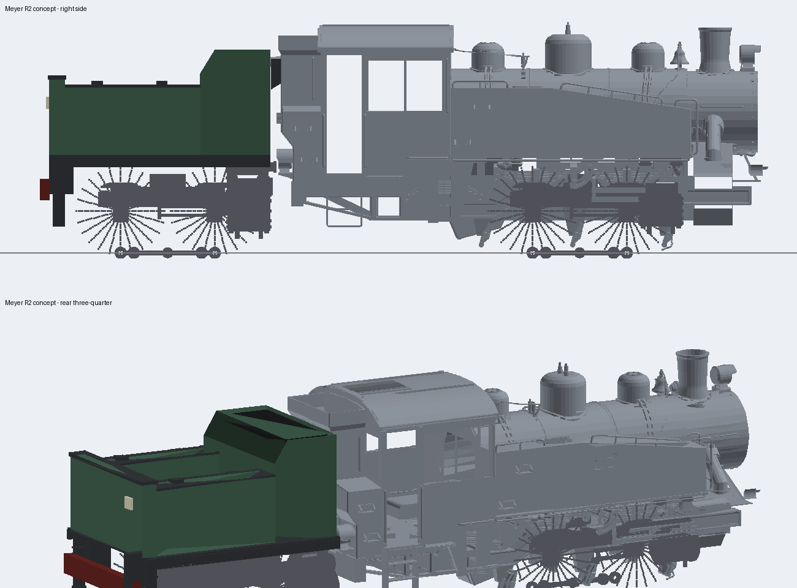

# Meyer R2: a long articulated tank engine — plan

Written 28 October 2026 by Claude. James asked for a more substantial rear: a
high coal hopper feeding down into the S060 bunker, bigger water tanks, and
bodywork that makes the Meyer read as one long articulated tank engine rather
than an S060 with a steam bogie attached. James chose real added capacity.

## Why it looks bolted on now

`Meyer/Authoring/MeyerDraftBuilder.cs` parents the rear deck, panniers and coal
box to the rear power bogie (`BogieR/bogie_car`), so they swing with it, sit low
(deck 1.55 m) and leave an open gap to the cab with the exhaust arching over it.
A real Meyer carries tanks and bunker on one rigid frame over two swivelling
engine units.

## Fit (measured)

Rear power unit (pivot z −6.10; frame, cylinders, rods, manifolds, S060 drivers)
swept through yaw ±6° (pivots 7 m apart), pitch/roll ±1°, ±20 mm: tops out at
1.51–1.61 m, reaches x ±1.63 at the forward-facing cylinders, z −7.77..−4.13.
So new bodywork above a running plate at 1.62–1.66 m — the S060's own plate
line — never meets it. The rear coupler is already on the car body (z −8.28).

## Bodywork (rigid, on the S060 body, z −4.36 .. −8.27)

- Running plate continuous with the S060's (1.62–1.66), valances, new rear buffer
  beam and frame extensions on the body.
- High coal hopper behind the cab, z −4.36..−5.55, full width, top 3.45 m (cab
  roof 3.87) with a sloped back and a sloped floor/chute feeding forward and
  down into the existing cab-back bunker. Rear cab windows keep a view over the
  sloped back.
- Long side tanks z −5.55..−7.85 with the S060 front tanks' section and top line
  (x 0.74–1.28, top 2.82), beaded edges, fillers; a centre well tank between them.
- Rear bulkhead/bunker back with lamp irons, the rear lamps and glass (moved off
  the bogie), steps, ladders and handrails.
- Exhaust transfer routed inside the bodywork with one short flexible joint over
  the rear pivot (the open arch goes).
- Real meshes from a parametric generator (as the Shay modules), paint sampled
  from the S060 atlas so liveries follow; frames in the dirty gunmetal finish.

## Capacity (real, James's choice)

| | Stock S060 | Meyer R2 addition | Meyer R2 total |
|---|---|---|---|
| Water | 4,500 L | side tanks 2.9 m³ + well 2.2 m³, ~85 % usable ≈ 4,300 L | ≈ 8,800 L |
| Coal | 1,200 kg | hopper ≈ 5.4 m³ gross, sloped floor ≈ 2.7 m³ × 0.85 t/m³ ≈ 2,300 kg | ≈ 3,500 kg |

Full extra ≈ 6.6 t, carried by the S060 body (more adhesion on both units).
DV's `ResourceContainer.capacity` is a readonly field (decompiled): the Meyer
sets it and the capacity port by reflection on apply and restores on removal,
clamping the amount when returning to stock (refuse the switch, or warn, if that
would spill). Saves store the normalised amount, so capacity must be applied
before the resource state loads (or the amount rescaled) — a save/load test is
mandatory. Water towers/coal stations read the capacity port.

## Work order

1. Freeze the fit (rear-unit sweep, body datum 1.62, overhang swing at −8.27).
2. Bodywork generator + CCL donor rebuild (Meyer pack 0.7.0 → 0.8.0): move rear
   lamps/effects and collision boxes from the bogie to the body; walkable plates.
3. Runtime: capacity apply/restore with save ordering; exhaust routing.
4. Audits (collision 7,062, lights, exhaust, cocks, oil), renders, package,
   install on James's go-ahead.
